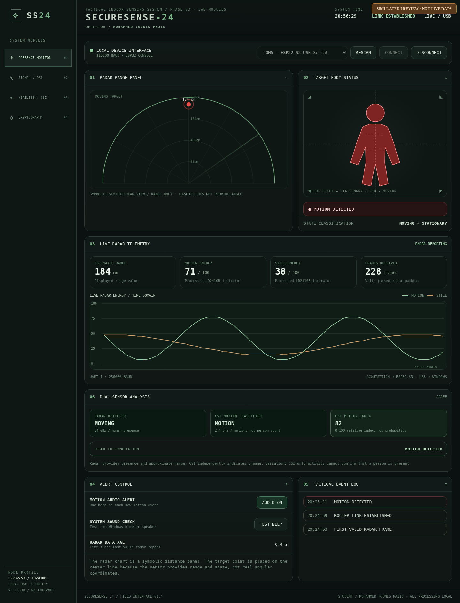
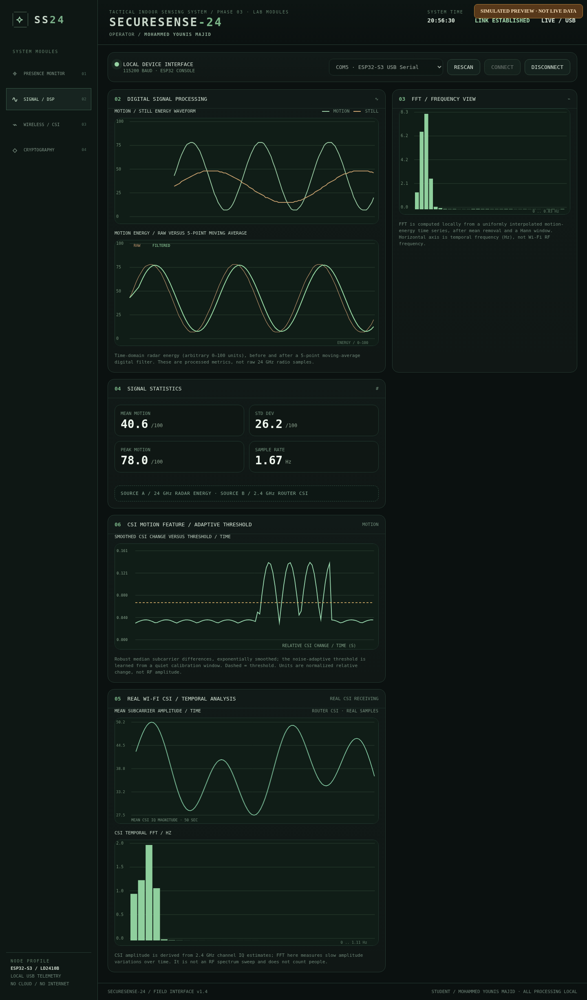
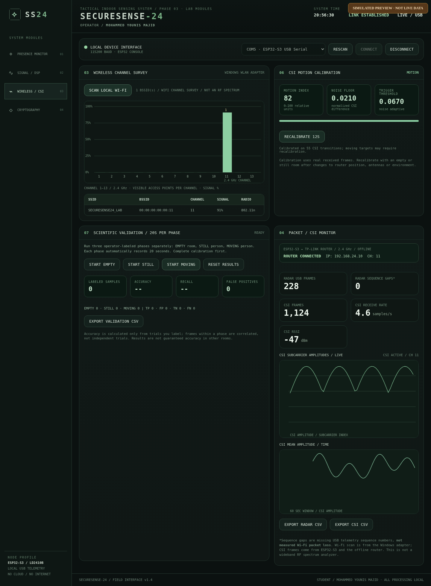
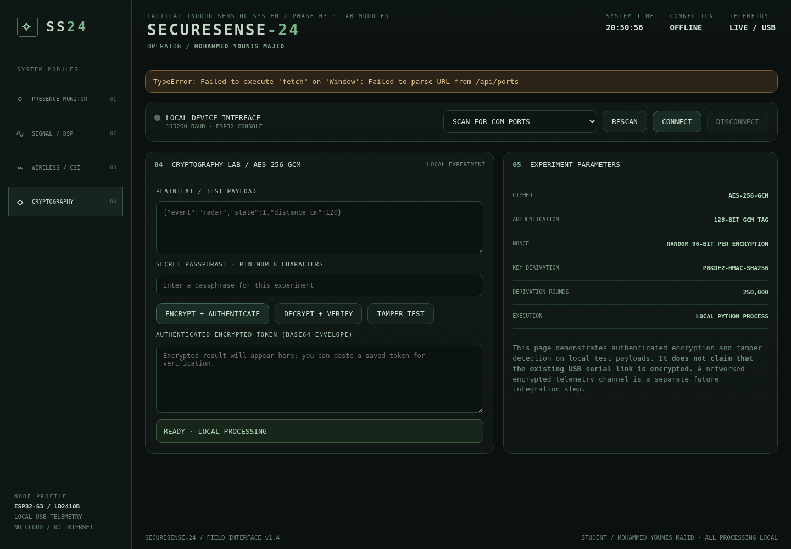

# SECURESENSE-24

**Offline radar + Wi-Fi Channel State Information (CSI) human-motion research platform**

[Wiring diagram](docs/wiring.svg) · [Academic report (PDF)](docs/report/SECURESENSE-24_Academic_Report_2026.pdf) · [Troubleshooting](docs/TROUBLESHOOTING.md)

Built by **Mohammed Younis Majid** · Northern Technical University · Cybersecurity & Cloud Computing Engineering · 2026.

**Private, proprietary project — All Rights Reserved.** This repository is intended for the owner and explicitly authorized collaborators, not public distribution. See [Proprietary Notice](PROPRIETARY_NOTICE.md).

> **Status:** Radar + router CSI were observed streaming live on the original ESP32-S3/Windows installation. The v1.4 classifier, evaluation workflow and AES-GCM lab passed software tests but are **not independently validated for accuracy across other installations**. The standalone firmware package has not been verified by rebuilding on a different hardware setup; build and validate it locally before relying on it.



*Illustrative program screenshot with simulated data, not evidence of classifier performance.*

## Overview

SECURESENSE-24 combines two sensing paths on **one** ESP32-S3:

- A **HLK-LD2410B 24 GHz presence radar**, connected through **UART1**; supplies processed moving/stationary presence state, approximate range, and energy indicators.
- **2.4 GHz Wi-Fi CSI** from a local Wi-Fi router; supplies per-frame receive-signal metrics and IQ-derived amplitude samples reflecting changes in multipath propagation.

The ESP32-S3 sends both as `SS24:` JSON records over **USB serial (115200 baud)**. A Windows Python backend receives the messages and serves a fully offline dashboard at **http://127.0.0.1:8765**. No cloud, SDR dongle, additional ESP32, or Internet connection is required.


## Hardware

| Part | Role |
|---|---|
| ESP32-S3 development board | Wi-Fi receiver, CSI capture, UART/USB bridge; **one ESP32-S3 only** |
| HLK-LD2410B radar module | 24 GHz presence/motion and range sensing; UART reporting at **256000 baud** |
| TP-Link TL-WR940N v6 or compatible 2.4 GHz router | Local 802.11 network and CSI packet source; **no WAN** required |
| Regulated **5 V** radar power (check your module's printed supply requirement) | Powers radar; share **GND** with ESP32-S3 |
| Windows 10/11 computer + USB data cable | ESP-IDF flashing and Python dashboard |
| 3 jumper/signal connections + appropriate power wiring | UART TX/RX crossed and common ground |

### Exact wiring used by this firmware

| ESP32-S3 | HLK-LD2410B | Notes |
|---|---|---|
| GPIO17 / UART1 TX | **RX** | ESP32 output to radar input, **3.3 V UART logic** |
| GPIO18 / UART1 RX | **TX** | Radar output to ESP32 input, **3.3 V UART logic** |
| GND | **GND** | Essential common ground |
| **regulated 5 V supply** | **VCC** | **Do not use 3V3 pin**. Use confirmed stable 5 V, observing board's current rating |
| *(not connected)* | OUT | Optional discrete output unused by this firmware |

**Very important:** HLK-LD2410B breakout connector variants differ; identify pins by the **labels on your actual board**, not by assumed left-to-right position. Never connect **5 V to an ESP32 GPIO**. USB can power the ESP32 board; if radar has separate 5 V supply, join grounds. Details and a safety checklist are in [docs/WIRING.md](docs/WIRING.md).

## Software prerequisites

- Windows 10/11 and Python 3.10+ (the app is designed for Windows because network scan uses `netsh`).
- ESP-IDF **6.x** environment with ESP32-S3 target; originally run with ESP-IDF 6.1. Verify compatibility for different releases.
- Wi-Fi router offering **2.4 GHz WPA2-PSK** and preferably DHCP + local gateway. No Internet access is required.
- MATLAB is **optional**, only for separate CSV analysis. The app itself uses Python/C/JavaScript and no MATLAB runtime.

## Quick start for an authorized collaborator

1. **Wire the radar** following the diagram and [safety notes](docs/WIRING.md). Power the ESP32 through USB and provide verified regulated 5 V to radar VCC, with common GND.
2. Configure a dedicated **2.4 GHz** local Wi-Fi network. A TP-Link TL-WR940N v6 is the reference router, but the code is not restricted to it.
3. In `firmware/main/`, **copy** `ss24_wifi_config.example.h` to `ss24_wifi_config.h` and enter the *lab* SSID/password. The real settings file is excluded from Git by `.gitignore`.
4. Open an **ESP-IDF terminal** from `firmware/`:

   ```powershell
   idf.py set-target esp32s3
   idf.py build
   idf.py -p COM5 flash monitor
   ```

   Replace `COM5` with your actual serial port. The repository provides a root `firmware/CMakeLists.txt` and enables CSI in `firmware/sdkconfig.defaults`.
5. Confirm sample serial records beginning `SS24:{"event":"radar"...}`, `SS24:{"event":"wifi"...}` and `SS24:{"event":"csi"...}`. The firmware uses local router ICMP reply traffic for CSI; the router needs to advertise/respond on the LAN.
6. Close the ESP-IDF monitor with **Ctrl + ]** to release the serial port. From Windows PowerShell:

   ```powershell
   cd windows_app
   py -3 -m pip install -r requirements.txt
   py -3 main.py
   ```

   Or double-click `windows_app/START_SECURESENSE24.bat` after installing requirements.
7. Open **http://127.0.0.1:8765**, select the ESP32 COM port and click **CONNECT**. The USB serial baud is **115200**, not the radar's UART1 baud **256000**.
8. Keep the room still for ~12 seconds for CSI baseline calibration; check **WIRELESS / CSI**, **PRESENCE MONITOR**, **SIGNAL / DSP**, **CRYPTOGRAPHY**. If you calibrate while walking, recalibrate when still.

> **Already have a working v1.3 firmware?** You can run the v1.4 Windows application **without reflashing anything**. This is the safest upgrade for the original demonstration.

## Dashboard screenshots

| Radar monitor | DSP analysis | Wi-Fi / CSI |
|---|---|---|
|  |  |  |

*Screenshots use simulated readings for UI illustration. On-device stream tests were performed separately; do not cite screenshots as measured data.*

### Cryptography lab (offline preview)



*Illustrative offline interface; AES-GCM is an application-payload experiment, not live transport encryption.*

## What does CSI mean?

**Channel State Information** describes the wireless channel response across OFDM subcarriers. Signals reflected or absorbed by objects and people follow multiple paths. When something moves, the received complex channel coefficients can change. In the firmware, the magnitude of signed IQ samples is calculated as `sqrt(I^2 + Q^2)` and sent as a vector. The app compares successive amplitude vectors, calibrates a robust threshold against quiet-room noise, and flags activity if the signal-change feature crosses the threshold with temporal hysteresis.

**CSI movement ≠ proven person detection.** Furniture, traffic, interference and environment changes can produce similar effects. LD2410B supplies a separate presence signal; the fusion display compares the two sources without inventing a person count or angular position. The plotted temporal FFT is **not a calibrated 2.4 GHz RF power spectrum**.

## Research features

- **Wireless Networks:** Router association, RSSI, CSI subcarrier amplitude traces, Windows WLAN scan (SSID/BSSID/channel/quality), local-only ICMP excitation.
- **Digital Signal Processing:** Radar energy waveform, smoothing/FFT, CSI inter-frame feature, EMA, median + MAD adaptive threshold, hysteresis, calibration and trial evaluation.
- **Cryptography:** AES-256-GCM encryption/decryption of lab payloads with PBKDF2-HMAC-SHA256 key derivation, tamper and wrong-password test. **The live USB serial transport is not encrypted**.
- **Validation:** Operator-labeled 20-second EMPTY/STILL/MOVING trials, exported CSV and sample-level Accuracy/Precision/Recall/F1. Adjacent CSI frames are **correlated**, not independent participants/trials.
- **Offline:** Web UI bound to `127.0.0.1`; ESP32 talks only to the local router.

## Repo layout

```text
SECURESENSE-24/
├── README.md
├── firmware/                     Standalone ESP-IDF project (ESP32-S3)
│   ├── CMakeLists.txt
│   ├── sdkconfig.defaults         CSI enable flag
│   └── main/
│       ├── hello_world_main.c     Radar UART + Wi-Fi CSI + JSON over USB
│       ├── CMakeLists.txt
│       └── ss24_wifi_config.example.h (copy to ignored .h)
├── firmware_radar_backup/        Prior radar-only firmware main component
├── windows_app/                  Python HTTP backend + HTML/CSS/JS UI
├── matlab/                       Standalone plots from CSV exports
├── tests/                        Python unit/integration tests
├── docs/
│   ├── wiring.svg                Editable wiring diagram
│   ├── WIRING.md
│   ├── ARCHITECTURE.md
│   ├── TROUBLESHOOTING.md
│   ├── screenshots/              Labeled illustrative previews
│   └── report/                   Academic PDF
├── .github/workflows/           Automated Python/JS checks
├── PROPRIETARY_NOTICE.md / NOTICE.md
└── SECURITY.md
```

## Tests

```powershell
py -3 -m pip install -r windows_app/requirements.txt
py -3 -m unittest discover -s tests -v
node --check windows_app/static/app.js
```

GitHub Actions runs the Python and JavaScript checks. **It does not simulate live RF, UART hardware, or compile ESP-IDF firmware.**

## Additional documentation

- [Detailed wiring](docs/WIRING.md)
- [Architecture and message format](docs/ARCHITECTURE.md)
- [Code-by-code walkthrough](docs/SOFTWARE_REFERENCE.md)
- [Troubleshooting](docs/TROUBLESHOOTING.md)
- [MATLAB data analysis](matlab/README.md)
- [Full academic report PDF](docs/report/SECURESENSE-24_Academic_Report_2026.pdf)
- [Software technical report](docs/TECHNICAL_REPORT_EN.md)
- [Private GitHub setup](docs/PRIVATE_GITHUB_SETUP.md)
- [Security/privacy policy](SECURITY.md) and [internal collaboration rules](CONTRIBUTING.md)

## Ownership and access

**Project:** SECURESENSE-24 | **Author and original rights holder:** Mohammed Younis Majid | **Academic context:** Northern Technical University, Cybersecurity & Cloud Computing Engineering, 2026. **Copyright © 2026. All Rights Reserved.** The author’s contributions are **proprietary and not open source**. Repository access and usage require authorization; see [PROPRIETARY_NOTICE.md](PROPRIETARY_NOTICE.md). Third-party licenses and institutional trademark rights are unaffected; see [NOTICE.md](NOTICE.md).

References: [Espressif ESP32-S3 Wi-Fi CSI APIs](https://docs.espressif.com/projects/esp-idf/en/stable/esp32s3/api-reference/network/esp_wifi.html), [ESP-IDF CSI configuration guide](https://docs.espressif.com/projects/esp-idf/en/latest/esp32s3/api-guides/wifi-driver/wifi-vendor-features.html), [Hi-Link LD2410B product information](https://www.hlktech.net/index.php?id=65).
