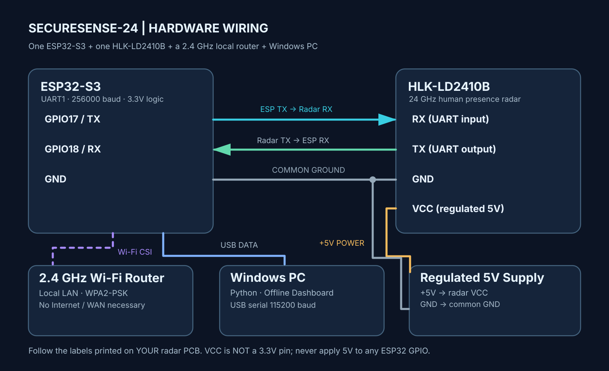

# Hardware wiring and electrical safety

## Wiring for the reference ESP32-S3 firmware

The module is connected to **UART1 at 256000 baud**. USB serial goes to Windows at **115200 baud**; these are two separate communication paths.

| LD2410B label | ESP32-S3 side | Direction | Signal specification |
|---|---|---|---|
| **RX** | GPIO17 (TX, UART1) | ESP32 → radar | 3.3 V logic |
| **TX** | GPIO18 (RX, UART1) | radar → ESP32 | 3.3 V logic |
| **GND** | GND | Common reference | Must share ground with power source |
| **VCC** | stable, regulated **5 V supply** | Power | **Not ESP32 3V3**; confirm your module variant |
| **OUT** | Not connected | Optional digital signal | Not required by UART firmware |

**Pin names on real hardware take precedence over any connector sketch.** LD2410 variants and breakout adaptors can put the same labels in different orders. The diagram is a **logical wiring diagram**, not a physical connector orientation or PCB layout.

### Before applying power

1. Disconnect power from everything.
2. Identify **VCC / GND / TX / RX** labels on both boards. ESP32-S3 boards have different layouts even when the chip is the same.
3. Verify power using a multimeter: a regulated 5 V supply that can handle radar current. Never use a nominal 3V3 output for this radar; never connect 5 V to ESP32-S3 GPIO.
4. Connect GPIO17 → radar RX, radar TX → GPIO18, and **all grounds together**. Leave OUT open.
5. If the radar is externally powered and ESP32 is USB-powered, the power supplies' GND must be common. **Do not short different 5 V supply outputs together.**
6. Connect the ESP32 USB data cable to Windows. The router communicates **wirelessly** with the ESP32; there is no wire between them.
7. Power on, then verify UART1 radar frames before relying on the dashboard.

### Why the Wi-Fi router needs no cable

CSI data is measured by the **ESP32-S3 radio** from locally received Wi-Fi packets. With the reference firmware the ESP32 associates with the router (2.4 GHz) and pings its **LAN gateway IP** repeatedly to elicit reply packets. Router Internet/WAN access is not needed; the router's local DHCP and ICMP responses matter.

### Pin/voltage references

- [Hi-Link manufacturer LD2410B information](https://www.hlktech.net/index.php?id=65) reports a 5 V working supply and 3.3 V serial output.
- [Espressif ESP32-S3 datasheet](https://www.espressif.com/sites/default/files/documentation/esp32-s3_datasheet_en.pdf) documents UART and GPIO matrix capabilities.
- Check the actual sensor board marking before following the 5 V instruction; breakout boards can have their own regulators/requirements.
